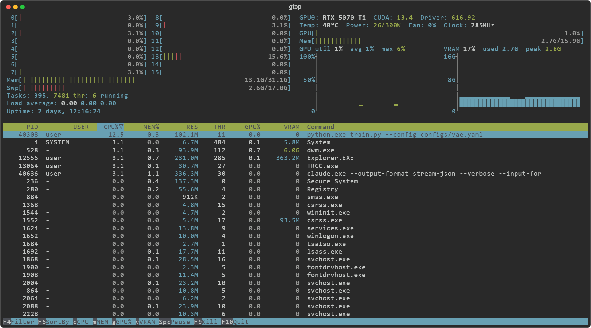

# gtop: htop + nvtop for Windows

**A terminal system monitor for Windows that shows CPU, memory, NVIDIA GPU usage and per-process VRAM in one window.**

gtop combines htop's CPU meters and process list with nvtop's GPU panel: usage and VRAM history charts, temperature, power and CUDA version. The process table shows each process's GPU% and VRAM, so you can see which process is using your GPU. It uses htop's familiar colors and layout.



## Why

htop doesn't run on Windows, and nvtop targets Linux. Task Manager shows per-process GPU use, but not in a terminal, and you can't sort it alongside CPU in an htop-style view. If you train models on a Windows machine, gtop shows everything in one place: which process is using the GPU, how much VRAM it holds, and whether the CPU is the bottleneck.

## Features

- **htop-style header:** a meter for each core, split into user (green), kernel (red), interrupt (yellow) and DPC (magenta) time, plus memory and swap meters, task and thread counts, and uptime
- **nvtop-style GPU panel:**
  - utilization, VRAM, temperature, power, fan and clock speed
  - CUDA and driver versions
  - history charts for usage and VRAM, with current, average and peak values
- **Per-process GPU% and VRAM**, read from the same Windows performance counters Task Manager uses (NVIDIA's NVML reports no per-process VRAM under WDDM)
- **Sorting** by CPU, memory, GPU% or VRAM with one key, or by clicking a column header
- **Filtering** by name, command line, user or PID, and **killing** a process after confirmation
- **Light on resources:** one `NtQuerySystemInformation` call per refresh (~10–30 ms with 400+ processes). Sampling runs in a background thread, so the UI stays responsive.

## Install

You need Windows 10 or 11 and Python 3.10 or newer. The GPU panel needs an NVIDIA GPU and driver; without one, gtop still works and the panel says no GPU was found.

With [uv](https://docs.astral.sh/uv/) (recommended):

```powershell
uv tool install git+https://github.com/gtmetric/gtop
```

Or with [pipx](https://pipx.pypa.io/):

```powershell
pipx install git+https://github.com/gtmetric/gtop
```

Then run `gtop`. If the command isn't found, open a new terminal so it picks up the updated PATH.

gtop runs on your installed Python rather than as a bundled `.exe`, because Windows Smart App Control blocks unsigned executables. uv and pipx still create a small unsigned `gtop.exe` launcher, though, and on some machines Smart App Control blocks it ("An Application Control policy has blocked this file"). If that happens, run gtop through the tool's Python, which is signed:

```powershell
# uv
& "$(uv tool dir)\gtop\Scripts\python.exe" -m gtop
# pipx
& "$env:LOCALAPPDATA\pipx\pipx\venvs\gtop\Scripts\python.exe" -m gtop
```

To keep typing just `gtop`, add a function to your PowerShell profile (`notepad $PROFILE`):

```powershell
function gtop { & "$(uv tool dir)\gtop\Scripts\python.exe" -m gtop @args }
```

## Usage

```
gtop [-d DELAY] [-s {cpu,mem,gpu,vram,pid,name,user,thr}]
```

| Key | Action |
|---|---|
| `c` `m` `g` `v` | Sort by CPU / memory / GPU% / VRAM (press again to reverse) |
| `p` `n` | Sort by PID / command |
| `F6` | Cycle through sort columns |
| click a header | Sort by that column |
| `F4` or `/` | Filter (Enter keeps it, Esc clears it) |
| `↑` `↓` `PgUp` `PgDn` | Move the selection (it then stays on that process) |
| `Home` | Back to the top |
| `F9` or `k` | Kill the selected process, after confirmation |
| `Space` | Pause updates |
| `+` / `-` | Refresh faster / slower |
| `F10`, `q` or `Ctrl+C` | Quit |

`python -m gtop.sampler --once` prints a single plain-text sample, which is handy for scripting or debugging.

## Notes

- **CPU% per process** follows htop's convention: 100% means one full core, so a busy multi-threaded process can exceed 100%.
- **The "running" count** is approximate, because Windows has no "R" process state. gtop counts processes that used at least 1% CPU in the last interval.
- **Load average** is psutil's emulation, based on Windows' processor queue length. It often stays near zero even under heavy CPU load.
- **Colors** come from your terminal's own 16-color palette, the same way htop does it.

## FAQ

**Is there htop for Windows?**
htop runs on Linux, macOS and the BSDs, but not on Windows. gtop reproduces htop's interface on Windows (same meters, colors, sortable process list and F-key bar) and adds GPU monitoring.

**Can I run nvtop on Windows?**
nvtop targets Linux. gtop gives you an nvtop-style GPU panel on Windows: utilization and VRAM history charts, temperature, power, fan, clocks, and CUDA and driver versions.

**How do I see which process is using my GPU or VRAM on Windows?**
Run `gtop` and press `v` to sort by VRAM, or `g` to sort by GPU%. Per-process numbers come from the same Windows GPU performance counters Task Manager uses. `nvidia-smi` shows "N/A" for per-process memory under the default WDDM driver mode.

**Does it work with AMD or Intel GPUs?**
Partly. The per-process GPU% and VRAM columns come from Windows' own counters, which work with any GPU vendor. The GPU panel (charts, temperature, power, CUDA version) uses NVIDIA's NVML and only appears with an NVIDIA GPU.

**Is it useful for deep learning / PyTorch training?**
That's what it was built for. You can watch GPU utilization and VRAM over time, spot a data-loading bottleneck (busy CPU, idle GPU), and see each training process's VRAM, all in one terminal next to your training run.

**Does it run on Linux?**
gtop is built for Windows. It has psutil fallbacks for other platforms, but they're untested; on Linux, htop and nvtop are the real thing.

## License

[MIT](LICENSE)
